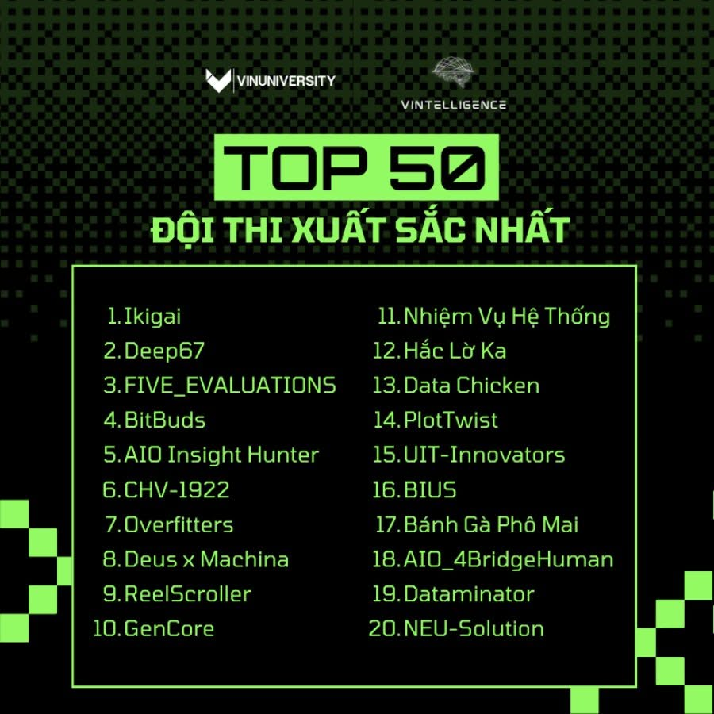

[Tiếng Việt](./README.md) | **English**

# E-Commerce Diagnostic Analysis & Revenue Forecasting (Datathon 2026)

Project submitted to **Datathon 2026** (VinUniversity) by team **Bánh Gà Phô Mai**.  
- **Result:** Top 17 overall (Top 50), scored 39/40 in Business Analysis.
- **My role:** Diagnostic analysis and business recommendations.
- **Full technical report (17 pages, Vietnamese):** [Read PDF here](./report/Banh_Ga_Pho_Mai_Report.pdf)

---

### 1. Business context & Dataset
The dataset simulates 10 years of operations (2012–2022) for a D2C fashion e-commerce business across 14 tables with 646,945 orders. After peaking in 2016 (~2.1B VND gross revenue), units sold dropped nearly 60% by 2022 despite overall market growth. Gross Profit Margin (GPM) remained critically low at around 14%.

### 2. Data integrity issues found before analysis
Cross-table reconciliation uncovered two major discrepancies:
- `unit_price` actually represents the pre-discount price (contradicting the data dictionary). `sales.csv` records gross revenue, while `payment_value` records net revenue.
- Revenue is recorded on an accrual basis without reversing cancelled orders. A total of 59,462 cancelled orders (9.2% of total revenue, ~1.52B VND) remained in the sales report despite having zero shipment records.

### 3. Root cause analysis
Testing three hypotheses (rising costs, poor post-purchase service, demand collapse) pointed to **Product-Market Fit (PMF) Erosion** as the core issue:
- **Customer Churn:** New customer acquisition dropped 95% over 9 years. Year-2 retention fell from 50–65% (2012–2013 cohorts) to 10–20% (2017–2019 cohorts).
- **Bloated, Underperforming Catalog:** Launching ~100 new SKUs per year failed to produce new hero products, leading to an accumulation of unsold inventory (Zombie products).
- **Systemic Inventory Mismatch:** Average days of supply surged from 161 days (2012) to 1,638 days (~4.5 years) in 2022. The direct cause was `reorder_flag` remaining at 0 for 10 straight years across all categories, disconnecting restocking from actual demand.

### 4. Strategic recommendations
- **Product & Inventory:** Liquidate SKUs with Sell-Through Rate (STR) below 30% to recover 350–400M VND in locked working capital. Stop launching 100 SKUs/year and focus R&D on frequently stocked-out items and high-margin GenZ lines.
- **Customer retention (RFM):** Run targeted email win-back campaigns for the *At Risk* segment (19.1% of customers) to recover 210–420M VND in LTV. Retain *Champions* (38%) with loyalty perks instead of blanket discounts.
- **Promotions:** Discontinue the margin-destructive *Urban Blowout* campaign (saving ~189M VND/year) and enforce discount caps by customer segment.

### 5. Forecasting models (Gradient Boosting + SHAP)
Daily Revenue and COGS forecasting using walk-forward validation to prevent data leakage:
- **Revenue (XGBoost):** RMSE = 695,216 | MAE = 518,797
- **COGS (CatBoost):** RMSE = 599,616 | MAE = 451,520
- **Top SHAP Drivers:** Recent sales momentum (`lag_1`, `lag_7`), day of month, and yearly seasonality.

---

### Recognition

  
  

