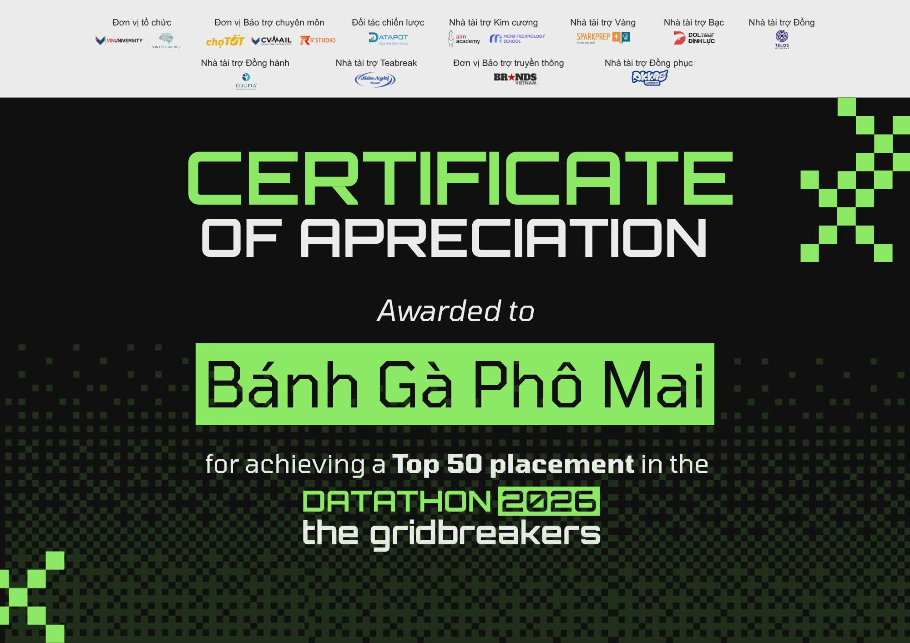
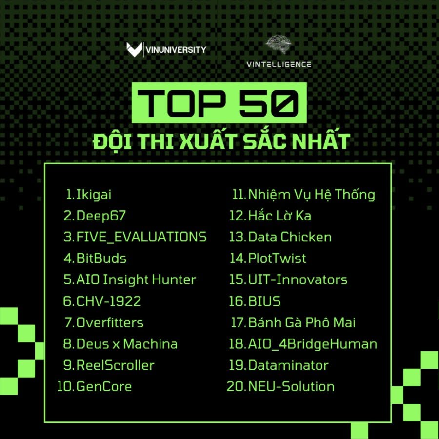

# Phân tích chẩn đoán và dự báo doanh thu TMĐT thời trang (Datathon 2026)

Dự án tham gia cuộc thi **Datathon 2026** (VinUniversity) của nhóm **Bánh Gà Phô Mai**.  
* **Kết quả:** Top 17 chung cuộc (Top 50), đạt 39/40 điểm phần phân tích kinh doanh.
* **Vai trò của tôi:** Diagnostic analysis và rút ra giải pháp kinh doanh.
* **Báo cáo chi tiết (17 trang):** [Xem file PDF tại đây](./report/Banh_Ga_Pho_Mai_Report.pdf)

---

### 1. Bối cảnh và Dữ liệu
Dữ liệu mô phỏng 10 năm hoạt động (2012-2022) của một doanh nghiệp thời trang bán lẻ trực tuyến (D2C) gồm 14 bảng với 646,945 đơn hàng. Sau khi đạt đỉnh năm 2016 (~2.1 tỷ VND doanh thu gộp), sản lượng bán ra giảm gần 60% vào năm 2022 dù thị trường chung vẫn tăng trưởng. Biên lợi nhuận gộp (GPM) duy trì ở mức thấp quanh 14%.

### 2. Lỗi dữ liệu phát hiện trước khi phân tích
Khi đối soát chéo giữa các bảng, nhóm phát hiện 2 điểm sai lệch quan trọng:
* Cột `unit_price` thực tế là giá trước giảm giá (ngược với mô tả trong từ điển dữ liệu). Bảng `sales.csv` ghi nhận doanh thu gộp, còn `payment_value` ghi nhận doanh thu thực thu.
* Hệ thống ghi nhận doanh thu theo kiểu dồn tích nhưng không trừ ngược đơn hủy. Có tới 59,462 đơn đã hủy (chiếm 9.2% tổng doanh thu, tương đương ~1.52 tỷ VND) vẫn nằm trong báo cáo doanh thu dù chưa hề giao hàng.

### 3. Chẩn đoán nguyên nhân gốc rễ
Kiểm định 3 giả thuyết (chi phí tăng, dịch vụ hậu mãi kém, nhu cầu sụt giảm) cho thấy vấn đề cốt lõi nằm ở việc **sản phẩm mất sức hút với thị trường (PMF Erosion)**:
* **Khách hàng rời bỏ:** Lượng khách mới giảm 95% sau 9 năm. Tỷ lệ giữ chân khách hàng năm thứ 2 tụt từ mức 50–65% (giai đoạn 2012-2013) xuống chỉ còn 10-20% (giai đoạn 2017–2019).
* **Danh mục sản phẩm phình to nhưng kém hiệu quả:** Doanh nghiệp tung ra khoảng 100 mẫu mới mỗi năm nhưng không tạo ra được sản phẩm chủ lực mới, dẫn đến tích tụ lượng lớn hàng tồn không bán được (Zombie products).
* **Tồn kho lệch pha do lỗi hệ thống:** Ngày tồn kho trung bình tăng từ 161 ngày (2012) lên 1,638 ngày (khoảng 4.5 năm) vào năm 2022. Nguyên nhân trực tiếp là cột cờ đặt hàng lại (`reorder_flag`) bằng 0 suốt 10 năm ở mọi ngành hàng, khiến việc nhập hàng tách rời hoàn toàn với sức mua thực tế.

### 4. Đề xuất giải quyết
* **Sản phẩm & Tồn kho:** Thanh lý các mã có tỷ lệ bán hết (STR) dưới 30% để thu hồi 350-400 triệu VND vốn đọng. Ngừng tung 100 mẫu mới/năm, tập trung phát triển dựa trên các mã thường xuyên hết hàng và nhóm hàng GenZ có biên lợi nhuận cao nhất.
* **Khách hàng (RFM):** Chạy chiến dịch email kéo lại nhóm *At Risk* (19.1% tệp khách) để phục hồi 210-420 triệu VND giá trị vòng đời (LTV). Giữ chân nhóm *Champions* (38%) bằng đặc quyền thay vì giảm giá đại trà.
* **Khuyến mãi:** Cắt bỏ chương trình *Urban Blowout* gây lỗ biên lợi nhuận (tiết kiệm ~189 triệu VND/năm) và áp trần mức giảm giá theo từng phân khúc.

### 5. Mô hình dự báo (Gradient boosting + SHAP)
Dự báo doanh thu và giá vốn theo ngày bằng phương pháp kiểm thử cuốn chiếu theo thời gian (walk-forward validation) để tránh rò rỉ dữ liệu từ tương lai:
* **Doanh thu (XGBoost):** RMSE = 695,216 | MAE = 518,797
* **Giá vốn (CatBoost):** RMSE = 599,616 | MAE = 451,520
* **Biến ảnh hưởng mạnh nhất (SHAP):** Sức mua gần nhất (`lag_1`, `lag_7`), ngày trong tháng và yếu tố mùa vụ năm.

---

### Chứng nhận

  
  

